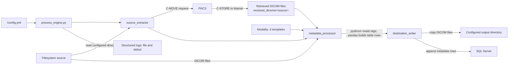
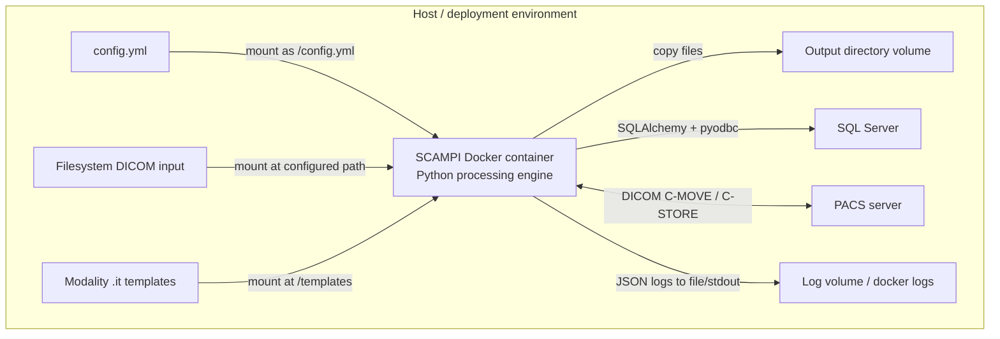

# SCAMPI Architecture
SCAMPI (Scalable Clinical Imaging Processing and Management) extracts DICOM files from a source (local filesystem or a PACS server), extracts their metadata according to per-modality templates, and writes the metadata to SQL Server alongside copying the files to an output directory.

## Architecture Overview

SCAMPI is a terminal-based batch-processing application. It is designed to be run via Docker container.
A configuration file, see [config wizard](https://hicresearch.github.io/SCAMPI/wizard.html), must be mounted to `/config/yml` within the Docker container.
This configuration files contains details about data sources, metadata destination and file destination.

### Processing flow

`process_engine.py` runs source extraction before metadata processing. Filesystem inputs are read from their configured directories; PACS inputs are retrieved with DICOM C-MOVE and received through SCAMPI's C-STORE listener under `./received_dicoms/<source_name>/`. For each DICOM file, the metadata processor reads the header without pixel data, selects a modality template, and assembles rows for the template's tables. The destination writer copies files to the configured output directory and appends the rows to SQL Server.

### Container and integrations

The input directory is needed for filesystem sources; PACS-only deployments do not need that mount. The configured output directory and template directory must be mounted at the paths used by `config.yml`. SQL Server and PACS are external services that the container must be able to reach.

### Runtime boundaries

- Configuration and modality templates are mounted inputs; the application does not provide a configuration UI or template editor.
- The engine runs the configured sources in sequence. Metadata extraction uses a local process pool; there is no message broker or distributed job queue.
- Metadata tables are written using SQL Server append semantics. DICOM files are copied to the configured output directory.
- Logs are emitted to stdout and to timestamped files under `/SCAMPI/logs/` in the container. Persist the files with a volume mount to retain them after the container exits.

For configuration fields and Docker run examples, see the [README](README.md).

## Logs

The application writes structured JSON logs. At runtime, log files are created at `/SCAMPI/logs/<timestamp>.log` inside the container. Log level is set to `DEBUG` in `process_engine.py`. To change it, adjust the `level` argument to `logging.basicConfig`.
